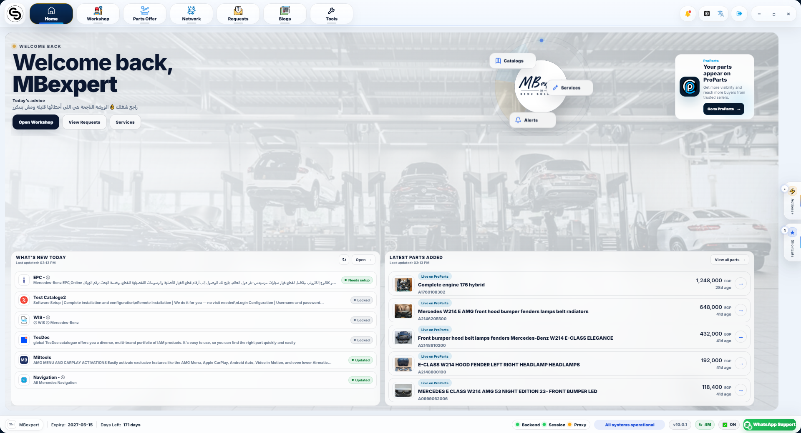
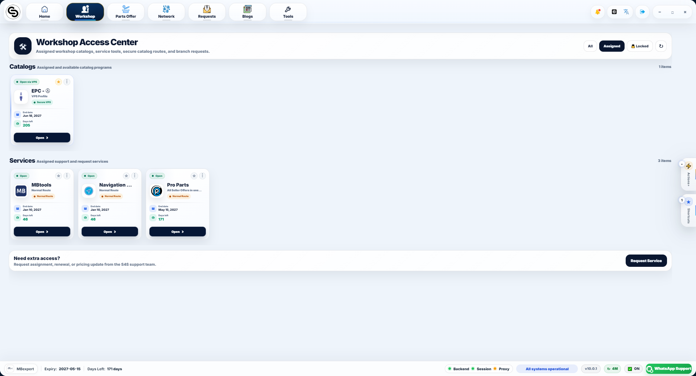
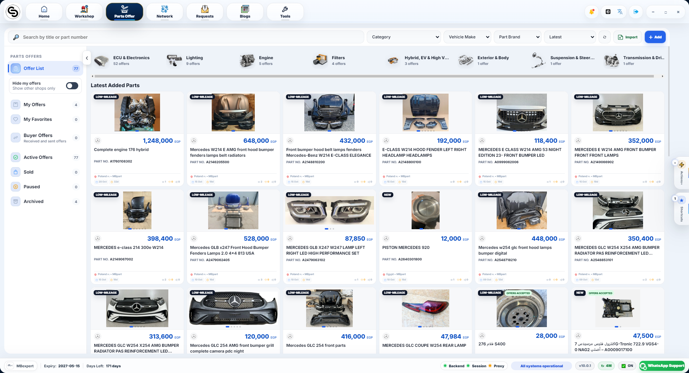
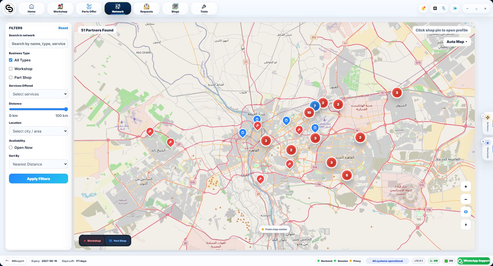
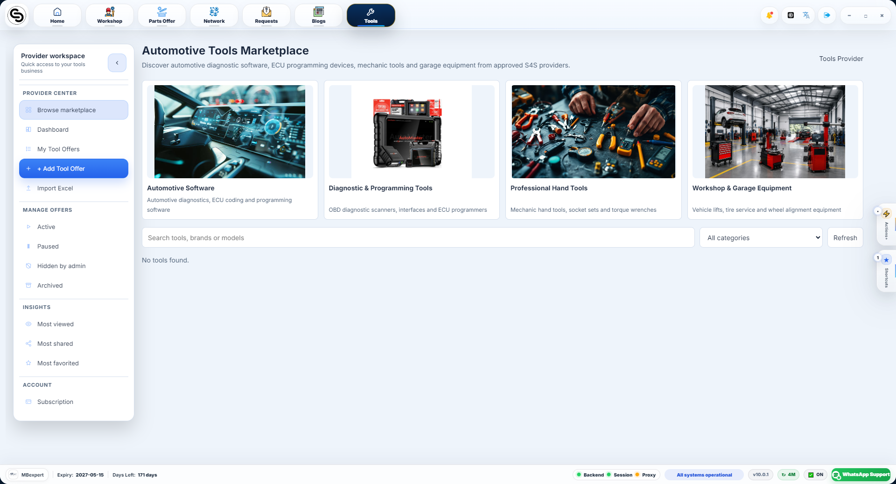
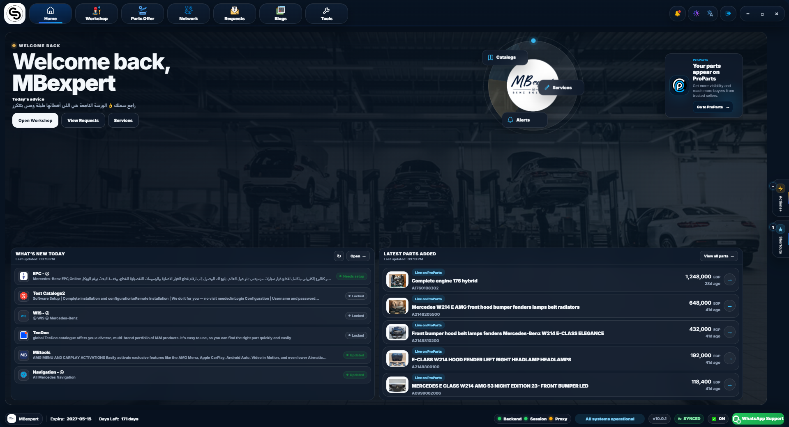
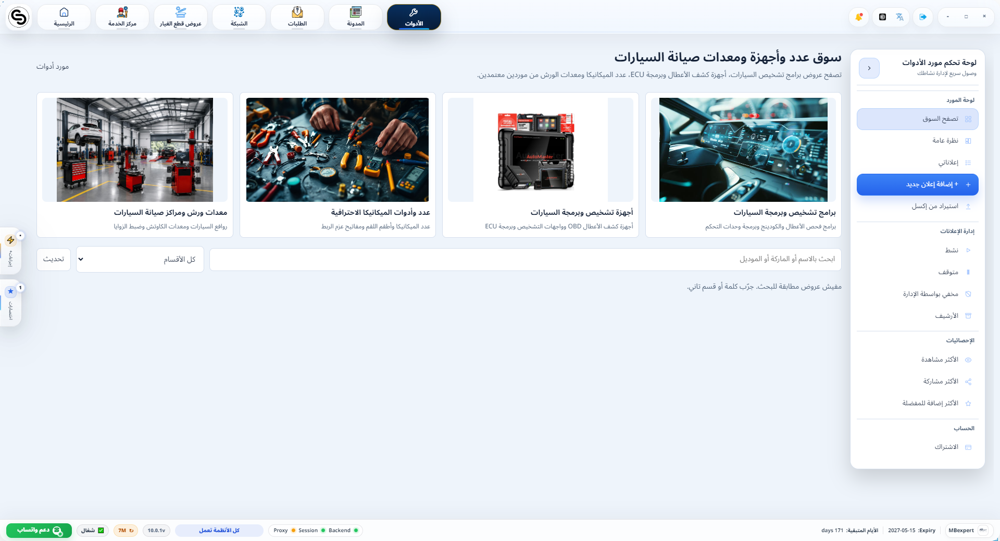

  

# S4S by GarageOS

### The Connected Platform for Automotive Professionals

---

## About S4S

S4S by GarageOS is a professional automotive desktop platform designed to connect independent workshops, diagnostic specialists, automotive programmers, spare parts suppliers and professional tool providers.

S4S brings automotive technical resources, digital marketplaces, business networking, specialist support and technical knowledge together in one connected workspace.

Developed around real automotive industry requirements, S4S aims to simplify everyday workflows and create new opportunities for automotive businesses.

## Core Features

| Module | Description |
| :--- | :--- |
| Home | Central professional dashboard, resources and notifications. |
| Workshop | Access authorized automotive catalogs and technical resources. |
| Part Shop | Access configured automotive parts catalogs and services. |
| Parts Offer | Automotive spare parts marketplace with advanced search, product listings and buyer offers. |
| Network | Discover workshops, parts suppliers and automotive specialists. |
| Requests | Submit technical support, programming, diagnostic and spare parts sourcing requests. |
| Blogs | Automotive technical articles, coding guides and educational resources. |
| Tools | Professional automotive software, diagnostic devices, hand tools and workshop equipment marketplace. |

## Application Screenshots

Explore the S4S desktop experience, designed around the daily needs of automotive professionals.

### Professional Dashboard

  

  <i>Your connected automotive workspace — resources, services and professional tools in one place.</i>

### Explore S4S Features

<table>
  <tr>
    <td width="50%" align="center">
      <b>Workshop & Technical Resources</b>  
       
      Access assigned automotive catalogs and technical resources.
    </td>
    <td width="50%" align="center">
      <b>Automotive Parts Marketplace</b>  
       
      Discover, publish and source automotive spare parts.
    </td>
  </tr>
  <tr>
    <td width="50%" align="center">
      <b>Automotive Business Network</b>  
       
      Discover workshops, suppliers and automotive specialists.
    </td>
    <td width="50%" align="center">
      <b>Professional Tools Marketplace</b>  
       
      Explore diagnostic equipment, software and professional workshop tools.
    </td>
  </tr>
  <tr>
    <td width="50%" align="center">
      <b>Modern Dark Mode</b>  
       
      A modern interface with personalized appearance settings.
    </td>
    <td width="50%" align="center">
      <b>Egyptian Arabic Interface</b>  
       
      Localized Arabic experience with right-to-left interface support.
    </td>
  </tr>
</table>

  <i>Click any gallery image to view it in full resolution.</i>

---

## Automotive Parts Marketplace

- OEM and reference part number search.
- Automotive parts listings and galleries.
- Advanced search and filtering.
- Buyer and seller communication.
- Excel and CSV inventory import.
- Favorites and listing management.

## Professional Tools Marketplace

Connecting automotive professionals with approved equipment and software providers.

### Marketplace Categories

- Automotive Software
- Diagnostic & Programming Tools
- Professional Hand Tools
- Workshop & Garage Equipment

Approved providers can publish products, manage offers, upload product images and use supported bulk import workflows.

## Automotive Business Network

Discover and connect with:

- Independent automotive workshops
- Diagnostic and programming specialists
- Automotive spare parts suppliers
- Professional tool providers
- Workshop equipment distributors

## User Experience

- Modern Windows desktop interface
- English and Egyptian Arabic
- Right-to-left language support
- Dark and light themes
- Account-based resource access
- Integrated notifications
- Connection diagnostics
- Application update workflow

## Technology Stack

## Development Roadmap

- [x] Core desktop platform
- [x] Automotive resource center
- [x] Spare parts marketplace
- [x] Automotive business network
- [x] Technical support requests
- [x] Professional tools marketplace
- [ ] Further marketplace performance improvements
- [ ] Windows installer code signing
- [ ] Enhanced provider analytics
- [ ] Improved accessibility and localization
- [ ] Expanded international capabilities
- [ ] Community developer resources

## Community & Feedback

We welcome feedback from automotive professionals and software developers.

- [Report an issue](https://github.com/garage-os/S4S/issues)
- [Request a feature](https://github.com/garage-os/S4S/issues/new)
- [GarageOS GitHub Organization](https://github.com/garage-os)

Please do not include passwords, customer information, VINs, account credentials or other sensitive information in public issues.

## Releases

Application releases and announcements will be published through verified GarageOS distribution channels.

[View GitHub Releases](https://github.com/garage-os/S4S/releases)

## About This Repository

This repository is the official public product information, documentation and community feedback repository for S4S by GarageOS.

The commercial application source code and private infrastructure are maintained separately.

S4S is an independent automotive software platform. Third-party resources are subject to applicable licensing, authorization and service availability.

## Connect With Us

- Website: https://garageos.pro
- Organization: https://github.com/garage-os
- Development: https://github.com/garageos-dev

---

### Built for Automotive Professionals.

**Connect. Discover. Collaborate. Grow.**

Developed and maintained by GarageOS.

Copyright 2026 GarageOS. All rights reserved.
